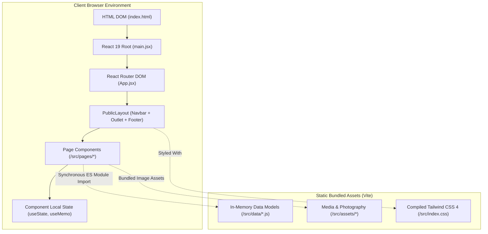
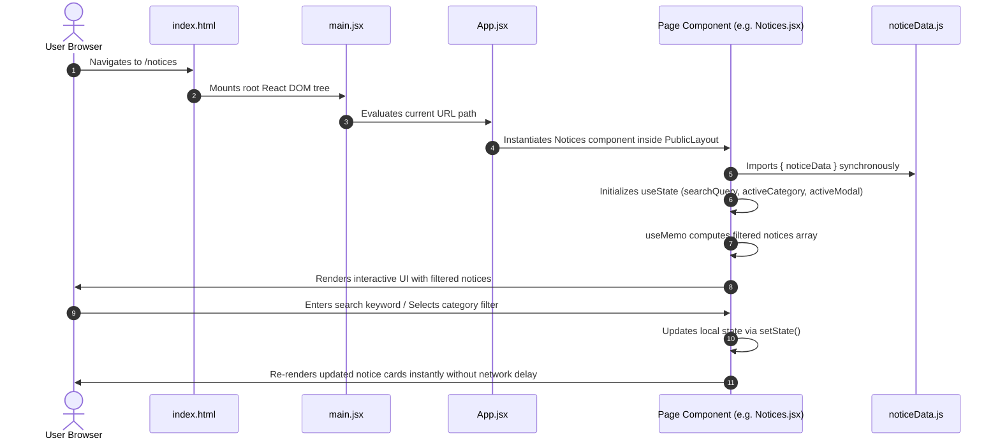
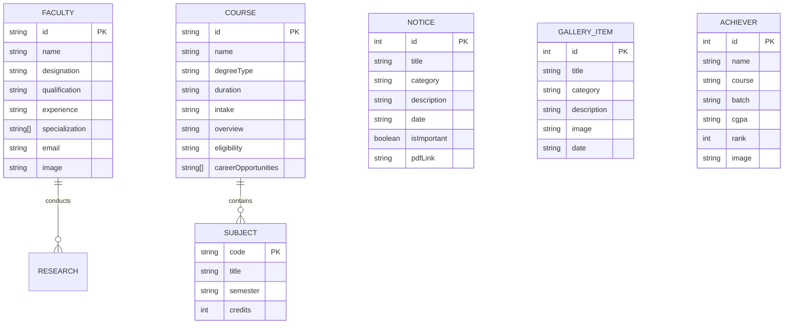

# SYSTEM ARCHITECTURE: CSKAC

## 1. High-Level System Architecture

The CSKAC project is architected as a **100% Client-Side Rendered (CSR) Single-Page Application (SPA)**. There are no server-side runtime containers or live backend microservices.



---

## 2. Component Hierarchy & Layout Structure

The layout hierarchy establishes persistent navigation and footer framing while dynamically mounting route targets inside the `<Outlet />`.

```mermaid
graph TD
    App["App.jsx (BrowserRouter)"]
    Routes["Routes Configuration"]
    PublicLayout["PublicLayout.jsx"]
    Navbar["Navbar.jsx (Sticky Header)"]
    Footer["Footer.jsx (Global Footer)"]
    Outlet["<Outlet />"]

    App --> Routes
    Routes --> PublicLayout
    PublicLayout --> Navbar
    PublicLayout --> Outlet
    PublicLayout --> Footer

    Outlet --> Home["Home.jsx"]
    Outlet --> About["About.jsx"]
    Outlet --> Faculty["Faculty.jsx"]
    Outlet --> Courses["Courses.jsx"]
    Outlet --> Notices["Notices.jsx"]
    Outlet --> Events["Events.jsx"]
    Outlet --> Gallery["Gallery.jsx"]
    Outlet --> Contact["Contact.jsx"]
    Outlet --> Research["Research (Resources.jsx)"]
    Outlet --> Achievements["Achievements (Resources.jsx)"]
    Outlet --> Unavailable["Unavailable (Resources.jsx)"]
    Outlet --> NotFound["NotFound (Resources.jsx)"]

    Home --> Hero["Hero.jsx (Carousel)"]
    Home --> AboutPreview["AboutPreview.jsx"]
    Home --> FacultyPreview["FacultyPreview.jsx"]
    Home --> [".jsx"]
    Home --> AchievementsPreview["AchievementsPreview.jsx"]
    Home --> GalleryPreview["GalleryPreview.jsx"]
```

---

## 3. Data Flow Architecture

Because there are no remote HTTP APIs or databases, data flows deterministically down the component tree through JavaScript module resolution and React component props.



---

## 4. Entity-Relationship & Data Schemas (JavaScript In-Memory Store)

The structured data exported from `src/data/*.js` functions as the application's domain schema:



---

## 5. Complete Application Execution Lifecycle

1. **Bootstrap Phase**:
   - The browser fetches `index.html`.
   - The HTML parser encounters `<script type="module" src="/src/main.jsx">`.
   - Vite loads compiled ES modules into the JavaScript engine.
   - `main.jsx` calls `createRoot(document.getElementById('root'))` and mounts `<App />`.

2. **Routing Phase**:
   - `App.jsx` evaluates the current browser URL (`window.location.pathname`).
   - If the path matches `/` or a valid route, it renders `PublicLayout` and the child page component.
   - If the path matches placeholder routes (`/syllabus`, `/alumni`, etc.), it renders `Unavailable`.
   - Any unknown path falls through to `NotFound`.

3. **Page Rendering & Interaction**:
   - The active page imports its respective data object from `src/data/*.js`.
   - Interactive components (such as `Hero` carousel, `Notices` filters, `Courses` curriculum tabs, and `Gallery` modals) initialize their component-scoped state via `useState`.
   - User inputs (filtering, tabs, clicking modal buttons) trigger internal re-renders. No network round-trips or API latency occur.

